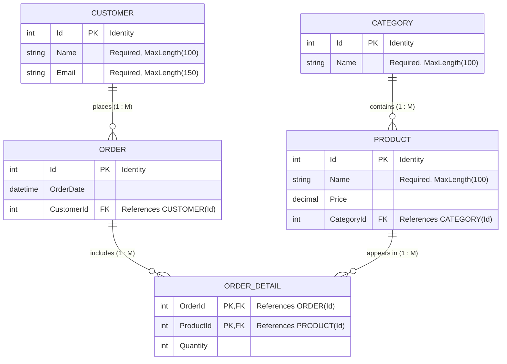

# Project 1: E-commerce System (Entity Framework Core)

## 1. Overview & Entities
This project models an **E-commerce System** using Entity Framework Core, establishing relationships between categories, products, customers, orders, and order details.

### Entities:
- **Category**:
  - `Id` (Primary Key, Identity)
  - `Name` (nvarchar(100), required)
  - Navigation: `ICollection<Product> Products`
- **Product**:
  - `Id` (Primary Key, Identity)
  - `Name` (nvarchar(100), required)
  - `Price` (decimal(18,2))
  - `CategoryId` (Foreign Key -> Category)
  - Navigations: `Category Category`, `ICollection<OrderDetail> OrderDetails`
- **Customer**:
  - `Id` (Primary Key, Identity)
  - `Name` (nvarchar(100), required)
  - `Email` (nvarchar(150), required)
  - Navigation: `ICollection<Order> Orders`
- **Order**:
  - `Id` (Primary Key, Identity)
  - `OrderDate` (datetime2)
  - `CustomerId` (Foreign Key -> Customer)
  - Navigations: `Customer Customer`, `ICollection<OrderDetail> OrderDetails`
- **OrderDetail** (Join Entity):
  - `OrderId` (Foreign Key -> Order)
  - `ProductId` (Foreign Key -> Product)
  - `Quantity` (int)
  - Navigations: `Order Order`, `Product Product`
  - Composite Primary Key: `(OrderId, ProductId)`

---

## 2. Database Relationship Diagram (ERD)

---

## 3. Relationships Mapping Summary:
- **One-to-Many**: Category to Product (`Category.Products` / `Product.Category`)
- **One-to-Many**: Customer to Order (`Customer.Orders` / `Order.Customer`)
- **Many-to-Many**: Order to Product through `OrderDetail` join table
