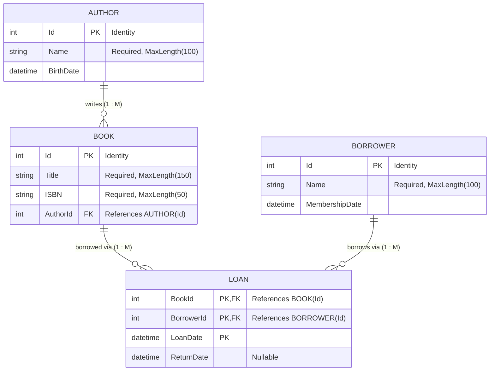

# Project 2: Library System (Entity Framework Core)

## 1. Overview & Entities
This project models a **Library Management System** using Entity Framework Core, establishing relationships between authors, books, borrowers, and loans.

### Entities:
- **Author**:
  - `Id` (Primary Key, Identity)
  - `Name` (nvarchar(100), required)
  - `BirthDate` (datetime2)
  - Navigation: `ICollection<Book> Books`
- **Book**:
  - `Id` (Primary Key, Identity)
  - `Title` (nvarchar(150), required)
  - `ISBN` (nvarchar(50), required)
  - `AuthorId` (Foreign Key -> Author)
  - Navigations: `Author Author`, `ICollection<Loan> Loans`
- **Borrower**:
  - `Id` (Primary Key, Identity)
  - `Name` (nvarchar(100), required)
  - `MembershipDate` (datetime2)
  - Navigation: `ICollection<Loan> Loans`
- **Loan** (Join Entity):
  - `BookId` (Foreign Key -> Book)
  - `BorrowerId` (Foreign Key -> Borrower)
  - `LoanDate` (datetime2)
  - `ReturnDate` (datetime2, nullable)
  - Navigations: `Book Book`, `Borrower Borrower`
  - Composite Primary Key: `(BookId, BorrowerId, LoanDate)`

---

## 2. Database Relationship Diagram (ERD)

---

## 3. Relationships Mapping Summary:
- **One-to-Many**: Author to Book (`Author.Books` / `Book.Author`)
- **Many-to-Many**: Book to Borrower through `Loan` join entity
