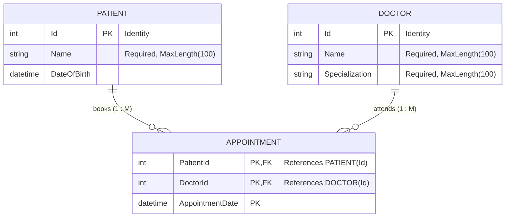

# Project 3: Health Care System (Entity Framework Core)

## 1. Overview & Entities
This project models a **Health Care Management System** using Entity Framework Core, demonstrating explicit navigation properties for many-to-many relationships via an intermediate entity.

### Entities:
- **Patient**:
  - `Id` (Primary Key, Identity)
  - `Name` (nvarchar(100), required)
  - `DateOfBirth` (datetime2)
  - Navigation Property: `ICollection<Appointment> Appointments`
- **Doctor**:
  - `Id` (Primary Key, Identity)
  - `Name` (nvarchar(100), required)
  - `Specialization` (nvarchar(100), required)
  - Navigation Property: `ICollection<Appointment> Appointments`
- **Appointment** (Join Entity):
  - `PatientId` (Foreign Key -> Patient)
  - `DoctorId` (Foreign Key -> Doctor)
  - `AppointmentDate` (datetime2)
  - Navigation Properties: `Patient Patient`, `Doctor Doctor`
  - Composite Primary Key: `(PatientId, DoctorId, AppointmentDate)`

---

## 2. Database Relationship Diagram (ERD)



---

## 3. LinkedIn Article: Understanding Navigation Properties in Entity Framework Core

### **Title**: Demystifying Navigation Properties in Entity Framework Core: From Relationships to Real Code

When developing applications with Entity Framework Core (EF Core), you rarely work with disconnected tables. Instead, domain models are richly interconnected: customers place orders, authors write books, and patients schedule appointments with doctors. 

At the center of navigating these connections in object-oriented code lies the concept of **Navigation Properties**.

---

### What Are Navigation Properties?

In relational databases, relationships are formed purely using **Foreign Keys (FK)**: a column in one table stores the primary key value of another table.

In C# and object-oriented programming, however, we don’t want to constantly perform manual joins using foreign key integer IDs. We want to navigate seamlessly between related objects:

```csharp
var doctorName = appointment.Doctor.Name;
var patientAppointments = patient.Appointments;
```

A **Navigation Property** is a property on an entity type that allows you to navigate from one end of a relationship to the other:
1. **Reference Navigation Property**: Points to a single related entity (e.g., `Appointment.Patient`, `Appointment.Doctor`). Represents the **"One"** side.
2. **Collection Navigation Property**: Points to multiple related entities (e.g., `Patient.Appointments`, `Doctor.Appointments`). Represents the **"Many"** side.

---

### Why Are They Crucial?

1. **Object-Relational Mapping (ORM) Fidelity**: They bridge the gap between relational foreign keys and object graph traversal.
2. **Clean Querying with Eager / Explicit Loading**:
   ```csharp
   var patientWithDoctor = context.Patients
       .Include(p => p.Appointments)
           .ThenInclude(a => a.Doctor)
       .FirstOrDefault(p => p.Id == 1);
   ```
3. **Encapsulation & Domain Logic**: Allows navigating the business aggregate without polluting domain logic with raw foreign key queries.

---

### Modeling Many-to-Many Relationships (Health Care System Case Study)

In our **Health Care System**, a patient can have appointments with multiple doctors, and a doctor treats multiple patients. Because an appointment has its own payload and identity (such as `AppointmentDate`), we model it using an explicit join entity:

```
[Patient] 1 <---> M [Appointment] M <---> 1 [Doctor]
```

#### The Fluent API Configuration:
```csharp
modelBuilder.Entity<Appointment>()
    .HasKey(a => new { a.PatientId, a.DoctorId, a.AppointmentDate });

modelBuilder.Entity<Appointment>()
    .HasOne(a => a.Patient)
    .WithMany(p => p.Appointments)
    .HasForeignKey(a => a.PatientId);

modelBuilder.Entity<Appointment>()
    .HasOne(a => a.Doctor)
    .WithMany(d => d.Appointments)
    .HasForeignKey(a => a.DoctorId);
```

### Key Takeaways
- Navigation properties transform static database records into rich, navigable C# domain models.
- Always provide inverse navigation properties when bidirectional traversal is needed.
- Using explicit join entities with navigation properties gives full control over payloads (dates, statuses, notes) in many-to-many associations.

#CSharp #DotNet #EntityFrameworkCore #CleanArchitecture #SoftwareEngineering #Databases #ORMMapping
